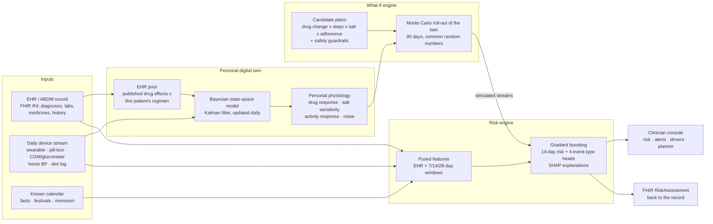

# HridayTwin: a cardiometabolic digital twin for Indian adults

**Happiest Health · Digital Twin Challenge 2026 · Proof-of-Concept submission**

> A living, personal model of each patient with type 2 diabetes and/or hypertension. It fuses the clinic record (EHR) with daily data from a wearable, a smart pill-box, a CGM or glucometer and a home BP cuff. It learns how *this* patient responds to their medicines, warns the care team before an adverse event, and lets a clinician test a care plan on the twin before trying it on the patient.

**Live clinician console (available after GitHub Pages deployment):** `https://DhruvikMS.github.io/hridaytwin/dashboard/` (GitHub Pages), or download `dashboard/index.html` and open it in any browser. It is a single self-contained file with no install.

> ⚠️ Research prototype trained and evaluated **only on synthetic patients** generated by this repository. Not a medical device; not for clinical use.

---

## Team details

| | |
|---|---|
| **Team name** | Winmasters |
| **Members** | Manjit Kalita, Dhruvik Sorathiya, Bishwarup Roy |
| **College / Incubator** | Goa Institute of Management · Incubator: Not applicable |
| **Contact** | dhruvik.sorathiya2026b@gim.ac.in |

## Project title

**HridayTwin: a personal digital twin that predicts adverse cardiometabolic events and personalises care for Indian adults with diabetes and hypertension**

## Healthcare use case

India has an estimated **101 million adults with diabetes and 315 million with hypertension** (ICMR-INDIAB, 2023), and the two travel together. Care happens in short, infrequent OPD visits; between visits, clinicians see nothing. The adverse events that fill emergency rooms are often visible in daily data days before they happen:

| Event | Typical Indian trigger the twin can see |
|---|---|
| **Severe hypoglycaemia** | Sulfonylurea (still widely prescribed in India) + religious fasting (Ekadashi, Shravan, Navratri) or a missed meal; CGM lows |
| **Hyperglycaemic crisis** | Missed doses, pharmacy refill gaps, monsoon-season fevers |
| **Hypertensive emergency** | Uncontrolled home BP, festival salt load, non-adherence |
| **Acute CV event** (MI, stroke, HF admission) | High baseline risk plus acute triggers: infection (resting-HR spike), BP surge |

**HridayTwin answers three questions for the care team every day:**
1. *Who* needs a call this week, and *why*? (14-day risk, per event type, with explanations)
2. *How does this patient actually respond* to their medicines, salt and activity? (personal twin parameters with uncertainty)
3. *What should we change?* (simulate candidate care plans on the twin, ranked, with safety guardrails, for clinician review)

## How it works



**The design rule: the twin simulates, the risk engine judges.** The twin is the *generative* half. It knows this patient's physiology and can roll their future forward under any plan. The risk engine is the *discriminative* half. It scores real and simulated futures with the same model, so a plan is judged exactly as the patient will be judged once it is in place. We arrived at this split from evidence: feeding the twin's internal state into the risk model made predictions *worse* (see Results).

More detail: [`docs/ARCHITECTURE.md`](docs/ARCHITECTURE.md).

## Key results (synthetic cohort, 1,200 patients x 180 days)

All numbers are regenerated by the pipeline into [`docs/RESULTS.md`](docs/RESULTS.md); none is typed by hand.

| Question | Result |
|---|---|
| Does the twin learn the individual? | Correlation of the twin's estimated drug response with each patient's hidden true response rises from **0** (EHR prior) to **0.64** (glucose) and **0.54** (BP) after 26 weeks of data |
| Is the twin calibrated? | **95%** of glucose and **97%** of home-BP readings fall inside the twin's own 2-sd expectation (ideal: 95%) |
| Does fusing wearables with the EHR help? | AUROC **0.726** fused vs **0.708** EHR-only (+0.017, 95% CI +0.004 to +0.032, patient-level bootstrap p = 0.008); fused beats EHR-only in **3/3** generator seeds |
| Versus what a clinic does today | Threshold rules on the same readings: AUROC 0.615 (fused is +0.111, p < 0.001) |
| Where the stream adds most | **Severe hypoglycaemia** AUROC **0.943** fused vs 0.907 EHR-only (p = 0.002) |
| At a workable alert load (10 per 100 patient-weeks) | 2.9x lift over base rate, median warning **7 days** before the event |
| Leakage check | Label-permutation control AUROC 0.515 (≈ 0.50 as required) |

**What did not work, reported as is.**
- Twin-state features hurt the risk model (−0.017 AUROC), so they are left out of it.
- The twin does not learn individual step sensitivity.
- Acute CV events are not improved by the stream.
- Timing *which week* is dangerous for a given patient is only modestly better than chance (0.56 within-patient AUROC).

These limits and their consequences are in [`docs/RESULTS.md`](docs/RESULTS.md#4-negative-findings-and-caveats).

## The clinician console

`dashboard/index.html`: one self-contained page over eight held-out synthetic patients (the console's model never trained on them), each a recognisable Indian OPD archetype: an elderly man fasting on a sulfonylurea, uncontrolled hypertension, poorly controlled diabetes, prior MI, diabetic kidney disease, young-onset diabetes and others.

- **Replay**: press play and watch 180 days unfold: risk, alerts and the twin's expectation band move day by day, as the care team would have seen them each morning.
- **Vitals vs twin**: observed glucose and home BP plotted against what the twin expected; readings outside the band are flagged as "twin surprise" alerts.
- **Why this risk today**: SHAP drivers in plain words.
- **Alert feed**: risk crossings, CGM lows below 54 mg/dL, 3-day missed-dose streaks, resting-HR spikes suggesting infection.
- **What-if planner**: choose one medicine change plus steps, salt and adherence support. See projected 14-day risk, HbA1c, home SBP and hypoglycaemia days over the next 90 days (which include Navratri fasts and Diwali), with fan charts and safety cautions. The twin's top three plans are ranked for clinician review.

## Technical stack

| Layer | Choice |
|---|---|
| Language | Python 3.10+ |
| Data | pandas, NumPy (vectorised (patients x days) arrays) |
| Twin | Custom vectorised Kalman filter (Bayesian linear state-space model), NumPy |
| ML | scikit-learn `HistGradientBoostingClassifier`, logistic regression baseline |
| Explainability | SHAP `TreeExplainer` |
| Interoperability | HL7 **FHIR R4** (Patient, Condition/SNOMED CT, Observation/LOINC, MedicationStatement, RiskAssessment), ABDM-ready |
| Console | Single-file HTML + vanilla JS + hand-built SVG charts (no framework; opens offline) |
| Quality | pytest (leakage, determinism, guardrail, FHIR round-trip tests), GitHub Actions CI |

## AI/ML model details

| | |
|---|---|
| **Twin model** | Two per-patient Bayesian linear state-space models (glucose, systolic BP). Inputs pass through a first-order physiological lag. Priors come from the EHR: HbA1c → eAG (ADAG), clinic BP, and the medication list x published average effects. Coefficients follow a slow random walk so the twin tracks drift. Updated daily by a Kalman filter; missing days are skipped, not imputed |
| **Risk task** | Binary: any adverse cardiometabolic event in the next 14 days, scored at weekly check-ins, plus 4 event-type heads |
| **Risk model** | `HistGradientBoostingClassifier` (250 iterations, 12 leaves, min 120 samples per leaf, L2 = 3), 59 fused features: 27 EHR + 29 causal stream windows + 3 known-calendar |
| **Validation** | 5-fold `GroupKFold` by patient; temporal + patient hold-out; ablations on identical folds; patient-level cluster bootstrap; label permutation; 3-seed sweep; twin vs hidden truth |
| **Calibration** | Brier 0.042, ECE 0.005; reliability curve in RESULTS |
| **Operating point** | Threshold set by an alert budget (10 alerts / 100 patient-weeks), not a fixed 0.5 |
| **What-if engine** | 16 Monte Carlo roll-outs per plan of the twin's own model, using the patient's learned coefficients, residual noise, observation gaps and the future calendar; common random numbers across plans. New-drug effects = published average x shrunk personal response (0.5 + 0.5 x learned multiplier) |
| **Guardrails** | eGFR thresholds (SGLT2i ≥ 20, metformin ≥ 30, DPP-4i renal dosing), regimen logic (no duplicate classes; up-titrate rather than add a second RAAS blocker), sulfonylurea/insulin hypoglycaemia cautions, IDF-DAR fasting plans, lab-monitoring reminders. Every plan is labelled **for clinician review** |

Full model card: [`docs/MODEL_CARD.md`](docs/MODEL_CARD.md).

## Quick start

```bash
git clone <this-repo> && cd hridaytwin
pip install -r requirements.txt
python run_pipeline.py          # full run incl. 3-seed sweep, ~15 min on a laptop CPU
python run_pipeline.py --quick  # 300 patients x 120 days, ~1 min
pytest -q                       # tests
```

Then open `dashboard/index.html`. Each step can also be run alone: `python -m hridaytwin.synth | model | validate | export_dashboard | fhir | report` (with `PYTHONPATH=src`).

Environment overrides: `HT_N_PATIENTS`, `HT_DAYS`, `HT_SEED`.

## Repository structure

```
hridaytwin/
├── run_pipeline.py            # one command: data → twin → models → validation → console → report
├── src/hridaytwin/
│   ├── config.py              # every tunable in one place
│   ├── synth.py               # mechanistic synthetic cohort (EHR + daily stream + events)
│   ├── twin.py                # the digital twin: EHR prior + daily Kalman update
│   ├── features.py            # causal fused features + labels
│   ├── model.py               # risk engine: training, ablations, bootstrap, temporal hold-out
│   ├── simulate.py            # what-if engine + clinical guardrails + plan ranking
│   ├── validate.py            # twin vs hidden truth; seed robustness
│   ├── export_dashboard.py    # held-out console data + SHAP + alerts
│   ├── fhir.py                # FHIR R4 export/import (ABDM-ready)
│   └── report.py              # generates docs/RESULTS.md + figures
├── dashboard/                 # template.html (source) → index.html (generated, self-contained)
├── model/                     # metrics.json, twin_validation.json, seed_robustness.json
├── data/sample/               # 2,000-row sample of each table (full data regenerates)
├── docs/                      # RESULTS (generated), ARCHITECTURE, MODEL_CARD, CLINICAL_RATIONALE,
│                              # DATA_DICTIONARY, VALIDATION_PLAN, ETHICS_PRIVACY, IMPACT, sample FHIR bundle
├── tests/                     # leakage, determinism, twin, guardrails, FHIR round-trip
└── .github/workflows/ci.yml
```

## Data, privacy and safety

- **No real patient data** is used or included. The generator ([`synth.py`](src/hridaytwin/synth.py)) is mechanistic: hidden personal physiology evolves day by day under medicines, adherence, activity, salt, carbohydrates, illness, monsoon and festival fasting. Its population priors come from published Indian figures ([`docs/CLINICAL_RATIONALE.md`](docs/CLINICAL_RATIONALE.md)). Events are drawn from the *hidden* state while the model sees only noisy, gappy observations, so labels cannot be read off any input column.
- Designed for India's **Digital Personal Data Protection Act 2023** and **ABDM** consent-managed exchange: purpose-limited, consent-artefact driven, data minimised. See [`docs/ETHICS_PRIVACY.md`](docs/ETHICS_PRIVACY.md).
- Decision support only. The console never acts on its own; every recommendation needs a clinician.

## From PoC to deployment

The path to real-world validation and deployment is set out in [`docs/VALIDATION_PLAN.md`](docs/VALIDATION_PLAN.md), and the impact and business case in [`docs/IMPACT.md`](docs/IMPACT.md):
1. Retrospective validation on paired EHR + device data from an Indian partner hospital, under IEC approval.
2. Prospective silent-mode pilot: the twin runs, the clinicians do not see it, outcomes are compared.
3. Clinician-in-the-loop pilot with alert-fatigue and safety monitoring; CDSCO software-as-a-medical-device pathway.

## License

MIT (code). Synthetic data generated by this code may be used freely.
