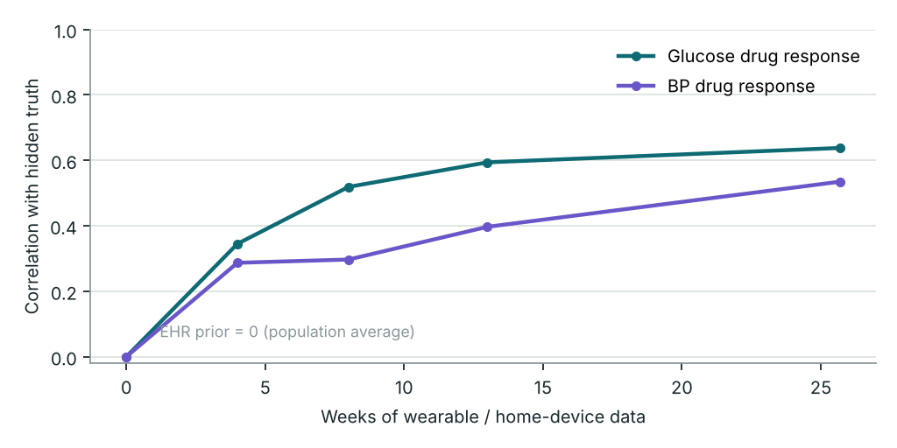
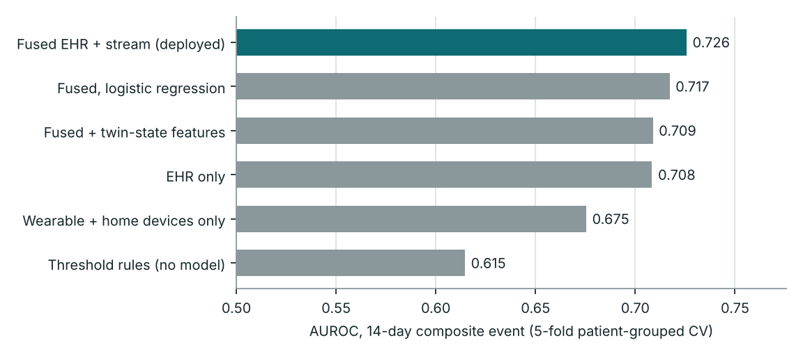
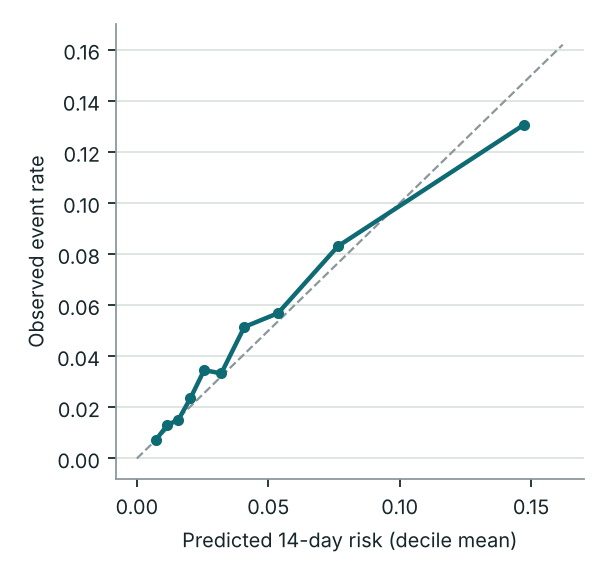

# Results

> **Generated file.** Produced by `python -m hridaytwin.report` from `model/metrics.json`, `model/twin_validation.json` and `model/seed_robustness.json`. Do not edit by hand.

> All numbers come from a **synthetic** cohort generated by this repository. They show that the pipeline works end to end and where each data source adds signal. They are not evidence of clinical performance.

Cohort: **1200 patients x 180 days**, 23,710 weekly prediction points, event base rate **4.5%** per 14-day window. Seed 2026. Full pipeline runtime 356 s on a laptop CPU.

## 1. Does the twin learn the individual patient?

The EHR prior assumes every patient responds to their medicines like the published average, so its correlation with each patient's true response is zero by construction. The twin updates that prior from the daily stream (pill-box adherence, CGM/glucometer, home BP, steps, resting HR).

| Weeks of data | Glucose: corr. with truth | Glucose: mean abs. error | BP: corr. with truth | BP: mean abs. error |
|---:|---:|---:|---:|---:|
| 0 (EHR prior) | 0.00 | 0.247 | 0.00 | 0.271 |
| 4 | 0.345 | 0.262 | 0.287 | 0.273 |
| 8 | 0.519 | 0.244 | 0.297 | 0.290 |
| 13 | 0.594 | 0.233 | 0.397 | 0.281 |
| 26 | 0.638 | 0.226 | 0.535 | 0.263 |

Glucose: 292 patients on glucose-lowering drugs; BP: 478 on BP-lowering drugs; patients whose treatment changed after an admission are excluded because their true response changed mid-stream. Error is in units of the response multiplier (1.0 = average responder).

Predictive calibration of the twin's daily expectations: glucose z-score mean 0.066, sd 0.981, 95% of readings within 2 sd; home SBP z mean -0.025, sd 0.891, 97% within 2 sd. A calibrated twin gives mean 0, sd 1, about 95% within 2 sd.

**Reading this table.** The twin learns to *rank* patients by how strongly their medicines work for them (correlation rises from 0 to 0.64 for glucose), which is what plan selection needs. Absolute error falls only modestly (0.247 to 0.226) because the filter shrinks estimates toward the prior until the data are strong. It learns because pill-box lapses act as natural on/off experiments.

**Limit.** It does **not** reliably recover each patient's step sensitivity (correlation with truth stayed near zero in development), so the activity arm of the what-if simulator relies mostly on the literature prior.

## 2. Does fusing wearables with the EHR predict adverse events better?

Task: at a weekly check-in, predict any adverse cardiometabolic event (severe hypoglycaemia, hyperglycaemic crisis, hypertensive emergency, acute CV event) in the next 14 days. 5-fold GroupKFold by patient: no patient is ever in both train and test.

| Model | AUROC | AUPRC | Brier | ECE |
|---|---:|---:|---:|---:|
| **Fused EHR + stream (deployed)** | 0.726 | 0.111 | 0.0416 | 0.0053 |
| Fused, logistic regression | 0.717 | 0.106 | – | – |
| Fused + twin-state features | 0.709 | 0.106 | 0.0418 | 0.0068 |
| EHR only | 0.708 | 0.096 | 0.0423 | 0.0104 |
| Wearable + home devices only | 0.675 | 0.098 | 0.0421 | 0.0072 |
| Threshold rules (no model) | 0.615 | 0.072 | – | – |

Paired comparisons on identical folds, two-sided p-values from a 1,000-resample **patient-level** cluster bootstrap:

| Comparison | Delta AUROC | 95% CI | p |
|---|---:|---|---:|
| fused vs ehr only | +0.0173 | [+0.0041, +0.0319] | 0.008 |
| fused vs stream only | +0.0503 | [+0.0336, +0.0656] | < 0.001 |
| fused vs fused plus twin state | +0.0169 | [+0.0066, +0.0276] | < 0.001 |
| fused vs fused logistic | +0.0085 | [-0.0051, +0.0214] | 0.226 |
| fused vs clinical rules | +0.1111 | [+0.0889, +0.1323] | < 0.001 |

**Temporal + patient hold-out** (train on weeks before day 97, test on day 111+ of unseen patients, n = 9,495): fused 0.686 vs EHR-only 0.681. The gain is smaller here than under cross-validation; we report both.

**Label-permutation control:** 0.515 (must be about 0.50; it is, so the pipeline does not leak labels).

### By event type

| Event | Positive windows | Fused AUROC | EHR-only AUROC | Delta (95% CI) | p |
|---|---:|---:|---:|---|---:|
| Severe hypoglycaemia | 133 | 0.943 | 0.907 | +0.036 [+0.015, +0.059] | 0.002 |
| Hyperglycaemic crisis | 260 | 0.858 | 0.847 | +0.012 [-0.005, +0.030] | 0.164 |
| Hypertensive emergency | 209 | 0.888 | 0.884 | +0.004 [-0.009, +0.019] | 0.564 |
| Acute CV event | 478 | 0.711 | 0.716 | -0.005 [-0.023, +0.010] | 0.544 |

The stream adds most where physiology moves fast and is measured directly: **severe hypoglycaemia** (CGM lows, fasting days, missed meals). Acute CV events stay dominated by baseline risk in the clinic record; the stream does not improve them here.

### Timing: can it tell *which week* is dangerous for the same patient?

Mean within-patient AUROC over the weeks **before each patient's first event**. The EHR is constant across those weeks, so it scores exactly 0.50; anything above that is the stream telling the clinician *when* to act.

| Model | Within-patient AUROC | Patients |
|---|---:|---:|
| EHR only | 0.500 | 309 |
| Wearable + home devices only | 0.522 | 309 |
| **Fused EHR + stream (deployed)** | 0.557 | 309 |
| Fused + twin-state features | 0.517 | 309 |

This signal is real but modest. Events here are short-lived hazard spikes (an infection, a fasting day), and a weekly 14-day forecast catches only part of them. Daily scoring and a shorter horizon are the obvious next experiment.

### Calibration and operating point

Alert budget **10 alerts per 100 patient-weeks** (threshold 9.4% risk):

| | Fused model | Threshold rules |
|---|---:|---:|
| Sensitivity | 29.1% | 23.9% |
| Positive predictive value | 13.1% | 10.8% |
| Lift over base rate | 2.91 | 2.39 |
| Median warning before event (days) | 7.0 | 7.0 |

## 3. Seed robustness

The whole pipeline (new cohort, new twin, new models) re-run under different generator seeds:

| Seed | Rows | Base rate | EHR-only | Fused | Fused + twin state | Fused - EHR | Timing (fused) |
|---:|---:|---:|---:|---:|---:|---:|---:|
| 2026 | 23,710 | 4.5% | 0.708 | 0.726 | 0.709 | +0.017 | 0.557 |
| 11 | 23,740 | 4.4% | 0.716 | 0.728 | 0.734 | +0.012 | 0.513 |
| 37 | 23,747 | 4.2% | 0.717 | 0.726 | 0.721 | +0.008 | 0.581 |

Fused minus EHR: **+0.012 +/- 0.005**; fused beats EHR-only in 3/3 seeds.

## 4. Negative findings and caveats

- **Twin-state features do not help the risk model.** Adding the twin's coefficients and surprise scores to the fused model lowered AUROC (+0.017 in favour of leaving them out). The deployed risk model therefore uses EHR + stream windows, and the twin's job is generative: learning the patient and simulating care plans. We chose this after seeing the result; it is a post-hoc decision and is labelled as one.

- **Model settings were chosen on the same cross-validation** (two regularisation settings compared). The temporal hold-out and seed sweep are the less optimistic checks.

- **Synthetic data.** The generator is mechanistic and literature-anchored, but its signal sits where we put it. Real validation needs paired EHR + wearable data from Indian patients (see `docs/VALIDATION_PLAN.md`).

- **What-if effects of new drugs** are published averages scaled by the patient's learned response; they are not causal estimates from this patient's data.
